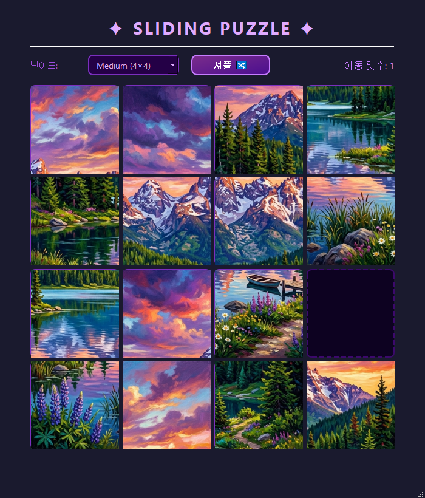

# 🧩 Sliding Puzzle

이미지를 격자로 잘라 섞은 뒤, 빈 칸 옆의 조각을 눌러 밀면서 원래 그림으로 맞추는 슬라이딩 퍼즐입니다.
PyQt5로 만들었고, 화면 배치는 Qt Designer 파일(`main_gui.ui`)로 분리했습니다.



## 기능

- 난이도 선택: **Easy (3×3)**, **Medium (4×4)**, **Hard (5×5)**
- 이미지를 난이도에 맞게 자동으로 분할해 타일로 사용 (정사각형 이미지 권장)
- 빈 칸과 맞닿은 타일만 이동 가능, 이동 횟수 표시
- **셔플** 버튼: 빈 칸을 무작위로 움직여 섞기 — 실제 이동으로만 섞기 때문에 항상 풀 수 있는 상태가 나옴
- 퍼즐을 완성하면 클리어 창과 함께 "다시 셔플" 선택 가능
- `puzzle_image.jpg`가 없으면 보라색 그라데이션 기본 이미지로 대체

## 실행 방법

Python 3 과 PyQt5가 필요합니다.

```bash
pip install -r requirements.txt
cd SlidingPuzzle
python main.py
```

> `main_gui.ui`와 `puzzle_image.jpg`를 상대 경로로 읽기 때문에, 반드시 `SlidingPuzzle` 폴더 안에서 실행해야 합니다.

## 파일 구성

| 파일 | 역할 |
|---|---|
| `main.py` | 게임 로직 (보드 상태, 이미지 분할, 셔플, 클리어 판정) |
| `main_gui.ui` | Qt Designer 화면 정의 (6×6 버튼 격자, 난이도 콤보박스, 셔플 버튼) |
| `puzzle_image.jpg` | 퍼즐에 쓰이는 이미지 |

## 동작 방식

- 화면에는 6×6 버튼이 미리 만들어져 있고, 난이도에 맞게 `size × size` 범위만 보이게 합니다.
- 보드는 2차원 리스트이며 `0`이 빈 칸입니다. 타일 번호는 `row * size + col + 1`이고, 이 번호가 곧 이미지 조각 번호입니다.
- 원본 이미지를 정사각형으로 맞춘 뒤 `size × size`로 잘라 각 버튼의 아이콘으로 넣습니다.

## 이미지 바꾸기

같은 폴더의 `puzzle_image.jpg`를 원하는 이미지로 교체하면 됩니다. 정사각형이 아니면 왼쪽 위 기준으로 정사각형만큼 잘라 씁니다.
